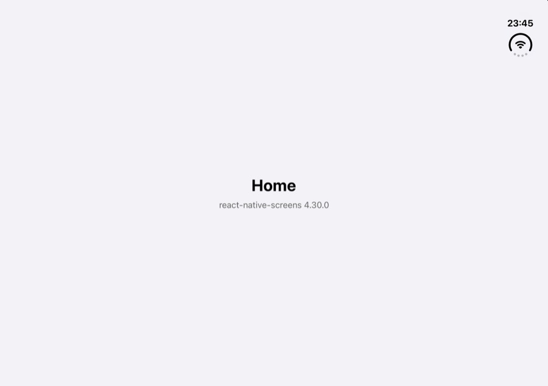
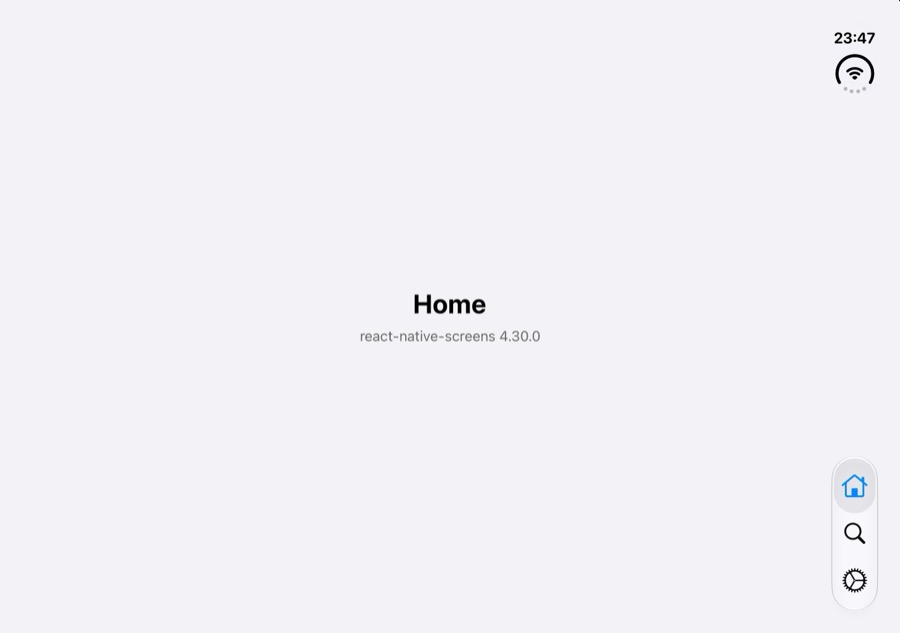
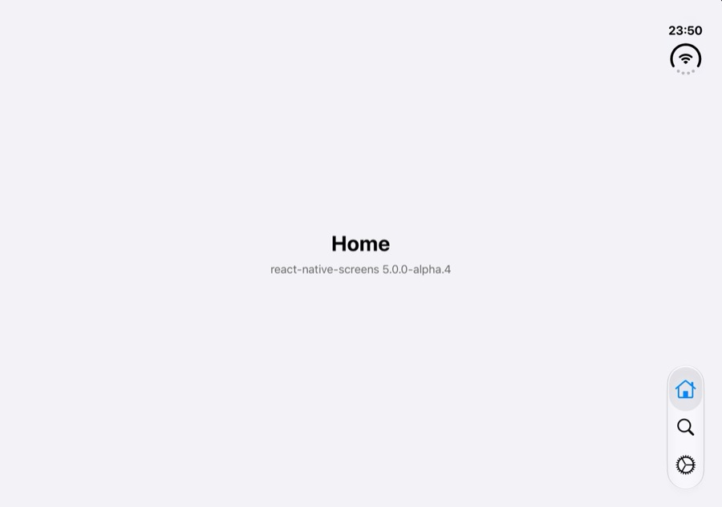

# Native tabs: side-rail tab bar missing after a cold launch on the unfolded iPhone Duo

Minimal reproduction for
[software-mansion/react-native-screens#4989](https://github.com/software-mansion/react-native-screens/issues/4989).

On the iPhone Duo simulator (iOS 27.1), an app with native bottom tabs that is cold-launched while the device
is **unfolded** shows no tab bar in the side rail. Launched folded, it is fine. Folding and unfolding once
brings the tab bar back.

| | Stock | With the one-line fix |
|---|---|---|
| react-native-screens 4.30.0 (`v4/`) |  |  |
| react-native-screens 5.0.0-alpha.4 (`v5/`) |  |  |

## What is in here

- `v4/` — Expo SDK 58 app (React Native 0.88, New Architecture) with expo-router `NativeTabs` and three tabs,
  on **react-native-screens 4.30.0** (latest stable on npm).
- `v5/` — the same app on **react-native-screens 5.0.0-alpha.4** (latest 5.x pre-release on npm). The only
  differences from `v4/` are the version in `package.json`, the app name and the bundle id.
- `v4/patches/`, `v5/patches/` — the one-line fix as a `patch-package` patch. It is **not** applied on
  install (there is no `postinstall` hook); you apply it explicitly to compare.
- `uikit-repro/` — the same bug in a plain UIKit app, no React Native (see below).

The whole app is `app/_layout.js` (a `NativeTabs` with three triggers) plus three one-line screens.

## Environment

- Xcode 27.1, iOS 27.1 simulator runtime, **iPhone Duo** simulator
- Expo SDK 58 (`expo@58.0.12`, `expo-router@58.0.21`), `react-native@0.88.0`, New Architecture, Hermes
- Verified with Release builds (JS bundle embedded, no Metro), so dev-server timing plays no part

## Steps

```sh
cd v4                     # or: cd v5
npm install
npx expo prebuild --platform ios
npx expo run:ios --configuration Release --no-bundler   # choose the iPhone Duo simulator
```

`expo run:ios` launches the app through a URL, so the simulator may ask "Open in …?"; that launch does not
matter, cancel it.

1. In Simulator, open Device Hub and **unfold** the iPhone Duo.
2. Quit the app (`xcrun simctl terminate <udid> dev.repro.rnsduotabs.v4`, or `.v5`).
3. **Cold-launch** it unfolded: tap its icon, or `xcrun simctl launch <udid> dev.repro.rnsduotabs.v4`.

**Expected:** the tab bar (Home / Search / Settings) floats in the side rail on the trailing edge.
**Actual:** no tab bar at all. The content is there, the rail is empty.

Controls:

- Cold launch while **folded**: the tab bar is there.
- Fold, then unfold a running app: the tab bar appears.

To take a screenshot of the inner display, use JPEG (a PNG of display 3 comes out black):
`xcrun simctl io <udid> screenshot --type=jpeg --display=3 shot.jpg`.

### With the fix

```sh
npx patch-package                                      # applies patches/react-native-screens+<version>.patch
npx expo run:ios --configuration Release --no-bundler
```

Repeat the steps above: the rail tab bar is present on every unfolded cold launch.
`npx patch-package --reverse` takes the fix out again.

## Results

Cold launches on the iPhone Duo simulator, screenshot of the inner display 5–7 s after launch:

| | Unfolded, stock | Unfolded, with the fix | Folded, stock |
|---|---|---|---|
| `v4/` react-native-screens 4.30.0 | 0/3 tab bar shown | 3/3 | tab bar shown (checked with the root `Stack` layout below) |
| `v5/` react-native-screens 5.0.0-alpha.4 | 0/3 | 3/3 | tab bar shown |
| `uikit-repro/` (no React Native) | 0/3 | 3/3 (`PREFRAME=1`) | — |

The same counts hold with `NativeTabs` nested in a root expo-router `Stack` (0/4 and 0/3 stock, 3/3 and 3/3
fixed), which is how most apps are laid out; the root `Stack` is not needed to trigger it.

## Root cause

1. `RNSTabsHostComponentView` loads `RNSTabBarController.view` while the controller is still detached
   (props, appearance), so UIKit sizes it to the main screen: the 466×678 **cover** display.
2. The tabs are installed (`setTabs:animated:NO`) in `mountingTransactionDidMount`, still detached.
3. `didMoveToWindow` then adds the controller's view to the host and pins it with Auto Layout **without
   setting a frame first**.
4. The resize from 466×678 to the 951×669 inner display changes no size class, and UIKit never
   builds the rail's floating bar. The `UITabBar` exists (`{882, 0, 69, 669}`, not hidden), but
   `_UITabContainerView` has no `_UIFloatingBarContainerView`, so nothing is drawn.
5. It is a UIKit bug (`uikit-repro/` reproduces it without React Native); react-native-screens' mount order
   happens to hit it on every unfolded launch.

## The fix

In `ios/tabs/host/RNSTabsHostComponentView.mm`, `-didMoveToWindow`, size the controller's view to the host
before attaching it. The code is the same in 4.30.0, 5.0.0-alpha.4 and current `main`:

```diff
 - (void)didMoveToWindow
 {
   if (self.window != nil && _controller.parentViewController == nil) {
+    _controller.view.frame = self.bounds;
     BOOL mountResult = [RNSContainerHelpers addChildViewController:_controller
                                           toViewControllerManaging:self.reactSuperview
                                                  withContainerView:self];
```

The constraints added right after take over from there, so the frame only decides the size the view has
when it joins the hierarchy.

## `uikit-repro/`: the same bug without React Native

A single-file Objective-C app (`main.m`, ~200 lines, no Xcode project) that does what react-native-screens
does: a `UITabBarController` is created detached, its view loaded and its tabs set, then it is added as a
child of a container already on screen, into a host subview, pinned with Auto Layout and no frame set.

```sh
cd uikit-repro
./build.sh
./run.sh <simulator-udid>              # prints RESULT BROKEN
PREFRAME=1 ./run.sh <simulator-udid>   # sets tbc.view.frame = host.bounds first: RESULT HEALTHY
```

Unfold the device in Device Hub before running. `run.sh` cold-launches the app, prints the health check from
the app's log and saves a screenshot to `uikit-repro/out/`.

## Checking health

Check for a `_UIFloatingBarContainerView` under `_UITabContainerView` (as `uikit-repro/main.m` does), or look
at the screenshot. `tabBar.subviews.count` is **not** a usable signal: a healthy rail tab bar can report 0
subviews too.
